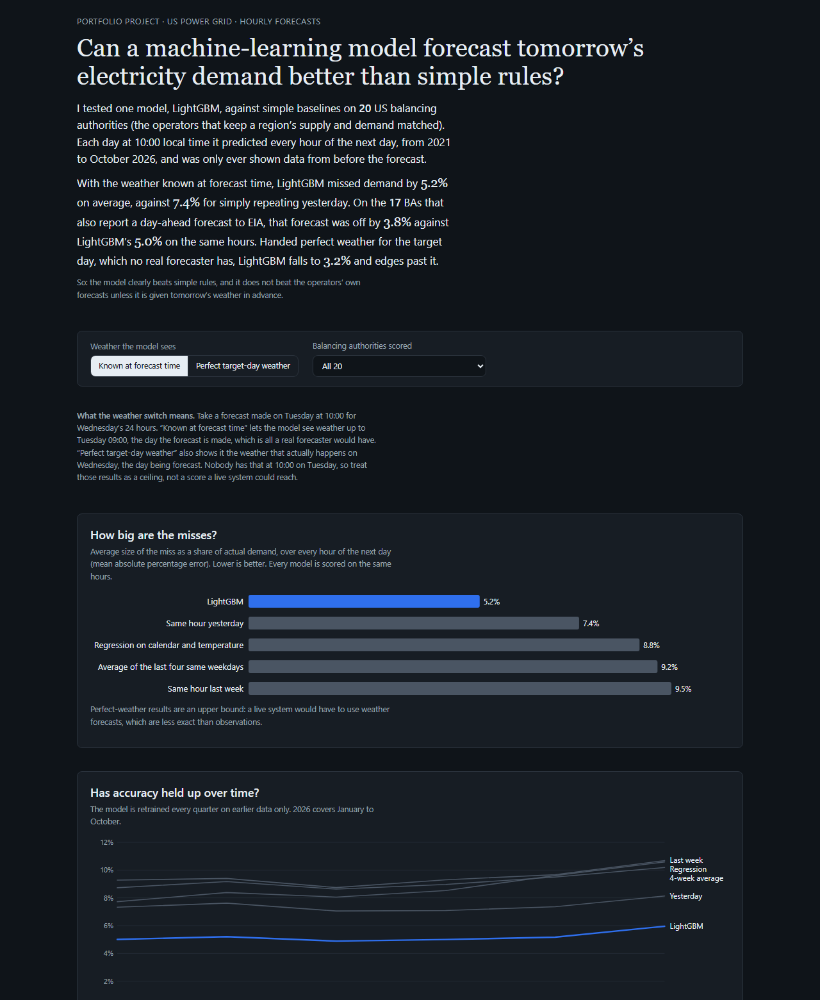

# Electricity Demand Forecasting



https://electricity-demand-forecasts.onrender.com

Next-day hourly electricity demand forecasts for 20 US balancing authorities (the operators that keep a region's supply and demand matched), tested from 2021 to October 2026 and scored by the average size of the miss as a percentage of actual demand. LightGBM, a gradient-boosted model, is compared with simple forecasts and with the day-ahead forecasts operators report to the U.S. Energy Information Administration (EIA).

## Headline

With weather known at the time of the forecast, LightGBM misses hourly demand by 5.18% on average (n = 1,015,245 hours across 20 BAs), against 7.41% for repeating yesterday's demand and 5.98% for a ridge regression on the same inputs. On the 17 BAs that report a day-ahead forecast to EIA, that forecast is more accurate than LightGBM over 2021 to 2026 (3.75% against 4.99%), and in 2026 the two cannot be told apart (a gap of +0.20 points, 95% interval -0.30 to +0.64). Given the next day's observed weather, which no live forecaster has, LightGBM reaches 3.32%. The figures describe the 20 largest, well-reporting BAs, and the 2021 to 2026 test period informed several design choices (see the [Methodology](docs/METHODOLOGY.md#validation)).

## Who's this for?

Reviewers of a forecasting project, data scientists, energy analysts curious how much a flexible model adds over simple rules

## What can it do?

It can answer these questions:

1. How does LightGBM compare with repeating yesterday's demand in ERCOT during the 2023 Texas heat, with and without the next day's weather? (Chart "What about extreme weather and holidays?", and the forecast viewer set to ERCO and the August 2023 week; 2,112 hours.)
2. Did the operators' day-ahead forecasts beat LightGBM in 2026? (Chart "Has accuracy held up over time?", with the BAs control set to the 17 with an operator forecast; 122,693 hours in 2026.)
3. Which BAs are hardest to forecast, and does that change when the model sees the next day's weather? (Chart "Where does it work, and where doesn't it?" with the weather switch toggled.)

## How to use it?

Set the weather switch and the BAs control at the top of the page; every chart updates together. Hover a bar or point for the figure and, in the model and storm charts, the number of hours behind it. Select a BA in the third chart, then pick a week to compare its hourly demand with each forecast.

## Data

| Source | What |
|---|---|
| [EIA Hourly Electric Grid Monitor](https://www.eia.gov/opendata/) (Form EIA-930), public domain | Hourly demand and each BA's day-ahead forecast, 2019-01-01 to 2026-11-03, pulled 2026-11-03; net generation and interchange for SRP and AZPS |
| [NOAA Integrated Surface Database](https://www.ncei.noaa.gov/products/land-based-station/integrated-surface-database), public domain | Hourly temperature, dew point and wind at 42 airport stations, 2019-01-01 to 2025-08-27 |
| [Iowa Environmental Mesonet](https://mesonet.agron.iastate.edu/), public domain, credit appreciated | The same stations from 2025-08-20 to 2026-11-03 |

Demand is the BA-reported hourly demand in megawatthours (EIA series `D`). The real data contains impossible readings (one PJM value of about 2.1 billion), which a backward-looking rule sets to missing: 332 of 1,374,422 hours across the 20 BAs. The test period has 1,022,880 target hours, of which 1,015,245 are scored (the others have no actual demand or a missing forecast input).

## Reading the numbers

- **Error** is the mean absolute percentage error over hourly forecasts: the average size of the miss as a share of actual demand. Differences between errors are in percentage points.
- **Variant A** gives the model weather observed up to 09:00 on the day the forecast is made. **Variant B** adds the weather observed on the day being forecast, which no live system has, so it is an upper bound. For a forecast made Tuesday at 10:00 for Wednesday, A sees weather through Tuesday 09:00 and B also sees Wednesday's actual weather.
- **Operator forecast** is the day-ahead forecast a BA reports to EIA. EIA publishes it and does not produce it. It is unusable for three BAs (FPC, PSCO, LGEE), so those comparisons cover 17 BAs.
- **2026** covers January to October.
- **SRP** reports demand that follows its exports in 2026, which no forecast here predicts.

[docs/METHODOLOGY.md](docs/METHODOLOGY.md) lists every cleaning step with its counts.

<!-- table:headline -->
| Forecast | A, 20 BAs | B, 20 BAs | A, 17 BAs | B, 17 BAs |
| --- | ---: | ---: | ---: | ---: |
| Same hour last week | 9.48 | 9.48 | 9.23 | 9.23 |
| Same hour yesterday | 7.41 | 7.41 | 7.18 | 7.18 |
| Average of the last four same weekdays | 9.17 | 9.17 | 9.00 | 9.00 |
| Regression (hour of week, holidays, temperature) | 8.77 | 7.69 | 8.66 | 7.65 |
| LightGBM | 5.18 | 3.32 | 4.99 | 3.21 |
| Operator forecast reported to EIA | n/a | n/a | 3.75 | 3.75 |
<!-- /table -->

Error in percent. The 17-BA columns score the five forecasts on the BAs that have an operator forecast.

## What the data shows

- **LightGBM beats simple rules.** 5.18% against 7.41% for yesterday's demand and 5.98% for the ridge regression. Against ridge the difference is -0.81 points (95% interval -0.86 to -0.75), and LightGBM is ahead in all 20 BAs and in every year.
- **Weather helps a little in practice and a lot in principle.** Weather known at the forecast time is worth 0.65 points to LightGBM; perfect next-day weather is worth 2.5.
- **The operator forecasts are better on average, and the lead is closing.** Over 2021 to 2026 they are ahead by 1.24 points (interval +1.12 to +1.36). The lead falls from 1.78 points in 2021 to 0.76 in 2025 and +0.20 in 2026.
- **Error rises in 2025 and 2026 for every forecast.** Most of it comes from SRP and from the operator forecasts getting worse in several BAs; LightGBM does not lose ground against the simple forecasts once SRP and AZPS are set aside.

## Run it

Python 3.12, 3.13 or 3.14 (the tests run on each in CI).

`results/` (every quoted figure as CSV, plus daily error sums that recompute the headline tables) and `site/` (the dashboard) are committed, so the figures can be checked and the dashboard viewed without downloading anything:

```bash
python -m venv .venv
source .venv/bin/activate        # Windows: .venv\Scripts\activate
pip install -r requirements.txt -r requirements-dev.txt
python -m pytest                                # checks the figures against the files
python -m http.server 8000 --directory site     # dashboard at http://localhost:8000
```

To rebuild everything from the EIA API, set the `EIA_API_KEY` environment variable (a free key; see `.env.example`) and run, in order:

```bash
python scripts/build_respondents.py && python scripts/ingest.py --types D,DF
python scripts/weather_stations.py && python scripts/ingest_weather.py && python scripts/ingest_iem.py && python scripts/weather_hourly.py
python scripts/run_evaluation.py --variant A && python scripts/run_evaluation.py --variant B   # about 17 and 27 minutes
python scripts/build_results.py && python scripts/build_site.py
```

The extra comparison models, SHAP, the sensitivity runs and the intervals have their own scripts; the [Methodology](docs/METHODOLOGY.md#reproducibility) gives the full run order. The dashboard is deployed as a Render static site; see [render.yaml](render.yaml).

## Tests

The tests check that forecasts use no information from after the forecast time, the cleaning rule, the scoring and walk-forward code, the models (on a small table, a retrain with the same seed gives identical forecasts), the data fetchers against mocked replies, and the committed results: the daily error sums recompute the headline tables, the dashboard data equals the tables, and the figures in these documents equal the files. They run offline in under a minute and do not cover page layout or the live deployment. CI runs them on Python 3.12, 3.13 and 3.14.

```bash
pip install -r requirements.txt -r requirements-dev.txt
python -m pytest
```

## Files

| File | Purpose |
|---|---|
| `electricity/` | The package: features, cleaning, models, scoring |
| `scripts/` | Data download, evaluation, results and site builders |
| `tests/` | The offline test suite |
| `results/` | Every quoted figure as CSV, bootstrap intervals, daily error sums |
| `dashboard/` | The dashboard page |
| `site/` | The built static site that Render serves |
| `docs/METHODOLOGY.md` | Data, cleaning, design, validation and results in full |
| `render.yaml` | The Render deployment |
| `requirements.txt`, `requirements-dev.txt`, `pytest.ini` | Pinned packages and test settings |

Released under the MIT License. EIA, NOAA and the Iowa Environmental Mesonet are credited above; this project is independent and is not affiliated with or endorsed by them.
